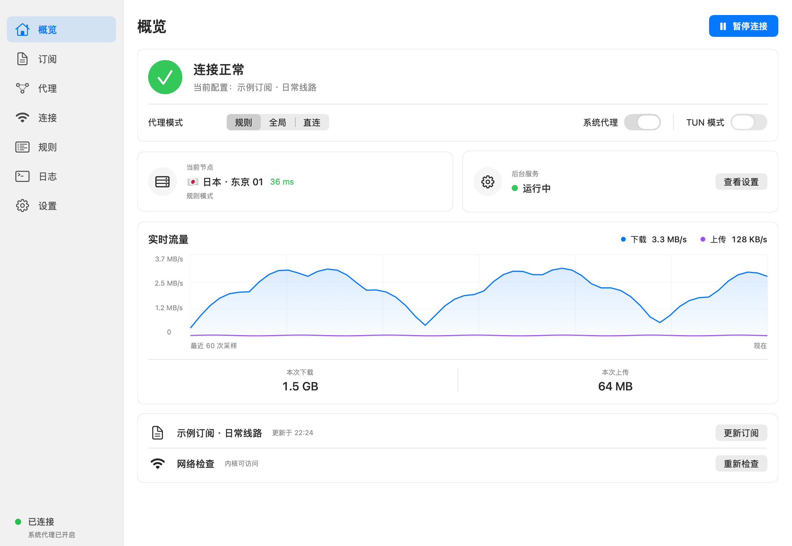
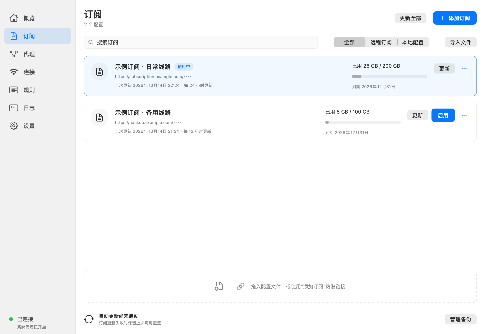
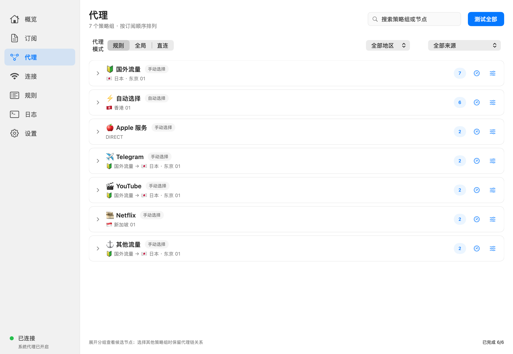
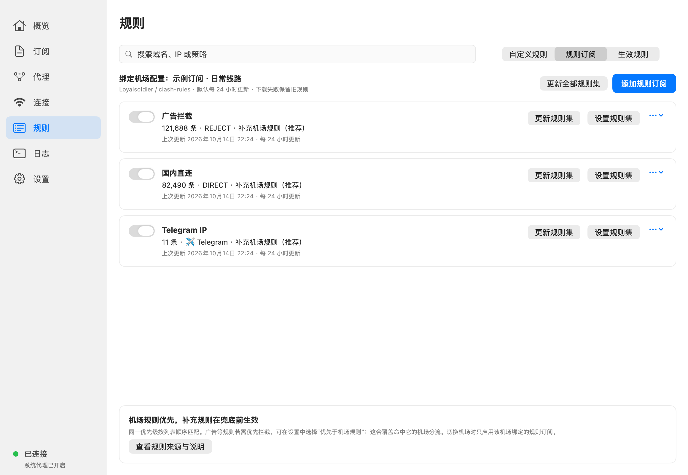
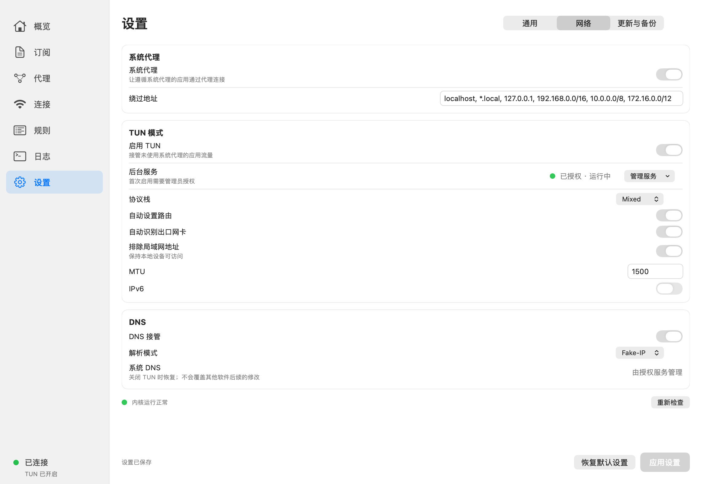
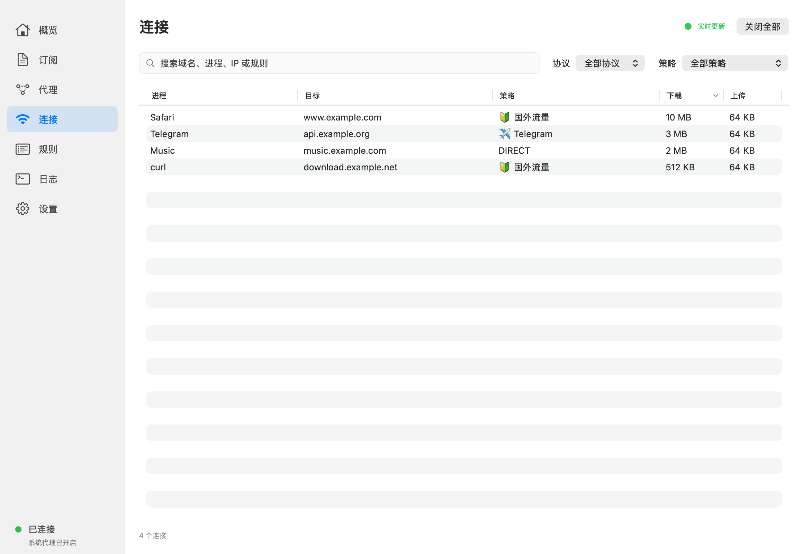
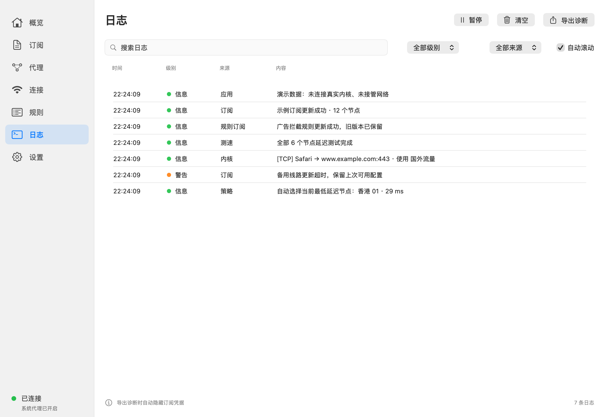
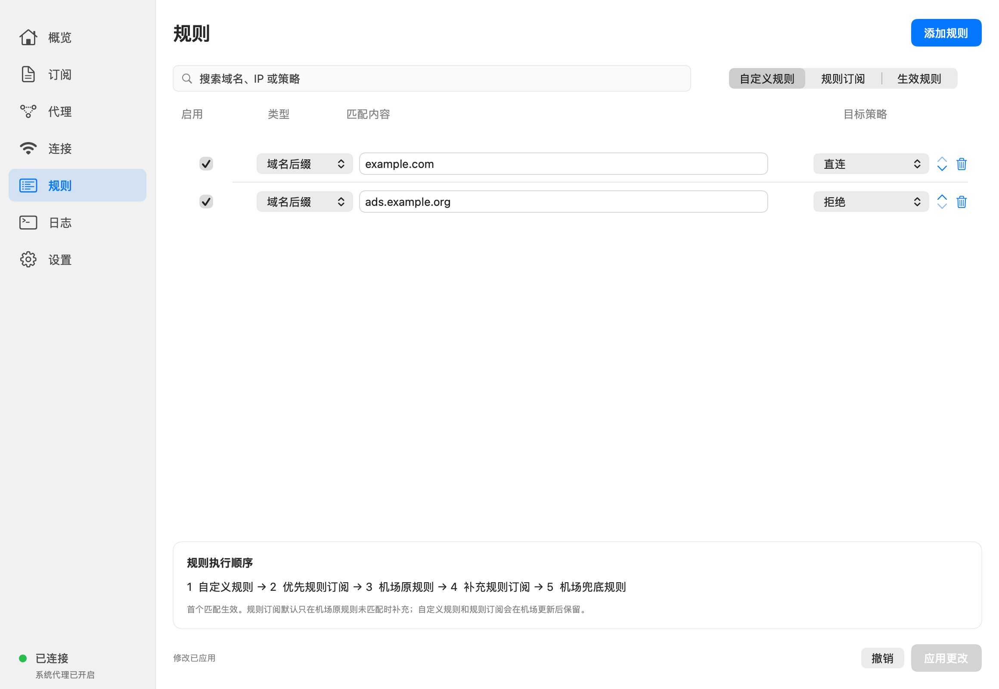

<div align="center">
  
  <h1>LumaRoute</h1>
  <p><strong>为 macOS 打造的原生代理管理工具</strong></p>
  <p>订阅、节点、分流与网络接管，在一个轻巧的桌面应用里完成。</p>
  <p>
    
    
    
    
  </p>
  <p>
    <a href="#功能一览">功能一览</a> ·
    <a href="#界面展示">界面展示</a> ·
    <a href="#构建与安装">构建与安装</a> ·
    <a href="#快速上手">快速上手</a> ·
    <a href="#常见问题">常见问题</a>
  </p>
</div>

<br />



LumaRoute 使用 **SwiftUI + AppKit** 构建桌面界面，由独立的 **[Mihomo](https://github.com/MetaCubeX/mihomo)** 内核处理代理与分流。保留订阅提供的策略组和规则，同时提供本地覆盖、自动选择与菜单栏快捷操作。

> 当前为开发预览版，主要面向本机自行构建使用。默认采用本地 ad-hoc 签名，无需购买 Apple 开发者证书；尚未提供经过 Developer ID 签名与公证的分发包。

## 功能一览

| 功能 | 支持内容 |
| --- | --- |
| **订阅管理** | 链接、文件与拖放导入；支持 YAML、URI 和 Base64 节点配置；多配置切换、手动及定时更新 |
| **订阅兼容** | 每个订阅独立设置 User-Agent；区分网络、HTTP、格式及内核校验错误；失败保留上次可用配置 |
| **节点与策略组** | 保留原分组名称、顺序与引用；节点切换、分组测速、批量测速、地区筛选与延迟排序 |
| **自动切换** | 保持订阅策略、最低延迟选择、故障转移；按订阅保存本地策略，支持恢复自动选择 |
| **规则订阅** | 内置 Loyalsoldier 的 13 个规则集；选择目标策略组、匹配优先级与更新周期；失败保留旧规则 |
| **自定义规则** | 域名、域名后缀、关键词、IPv4 / IPv6 网段；支持排序、撤销与应用 |
| **系统代理与 TUN** | 独立开关；可配置协议栈、路由、DNS、MTU、IPv6 与局域网排除 |
| **连接与日志** | 按进程、目标、协议和策略筛选连接；关闭单条或全部连接；搜索日志、暂停及导出诊断 |
| **菜单栏常驻** | 原生级联菜单、节点切换、双行实时速率、测速、系统代理与 TUN 快捷操作 |
| **维护与恢复** | 内核和 GEO 数据更新、校验与回退；本地备份、恢复与后台服务安装后自动刷新 |

## 界面展示

以下图片由**当前 SwiftUI 界面组件使用演示数据离线渲染**，用于展示实际布局；其中订阅、节点、流量及连接均为示例，不包含真实账号或网络记录。早期设计稿另见 [design](design/)。

<table>
  <tr>
    <td width="50%"><strong>订阅管理</strong><br /></td>
    <td width="50%"><strong>代理与策略组</strong><br /></td>
  </tr>
  <tr>
    <td><strong>规则订阅</strong><br /></td>
    <td><strong>系统代理与 TUN</strong><br /></td>
  </tr>
  <tr>
    <td><strong>连接查看器</strong><br /></td>
    <td><strong>运行日志</strong><br /></td>
  </tr>
</table>

<details>
  <summary>查看自定义规则界面</summary>
  <br />
  
</details>

## 构建与安装

### 环境要求

- **macOS 14 或更新版本**。
- **Xcode 或 Apple Command Line Tools**，提供 Swift 编译器及 macOS SDK。
- **Python 3**，用于下载并校验官方内核和 GEO 数据。
- 首次构建需联网访问 GitHub，获取 Yams 依赖、Mihomo 内核与 GEO 数据。

脚本根据本机架构选择 `arm64` 或 `x86_64` 内核。现有运行验收在 Apple Silicon Mac 上完成。

如果还没有安装命令行开发工具：

```sh
xcode-select --install
```

### 从源码构建

```sh
git clone https://github.com/onlyone1019/LumaRoute.git
cd LumaRoute
./script/build_and_run.sh --build-only
```

构建脚本会下载所需资源、执行 Release 构建、生成应用图标，并对应用和内核进行本地 ad-hoc 签名。生成的应用位于：

```text
dist/LumaRoute.app
```

如需构建后直接启动，可运行 `./script/build_and_run.sh`。该命令会先退出已运行的 LumaRoute；只构建时使用 `--build-only`。

### 安装到“应用程序”

1. 退出正在运行的旧版 LumaRoute。
2. 在 Finder 中打开项目的 `dist` 文件夹，将 `LumaRoute.app` 拖到“应用程序”。
3. 从“应用程序”启动 LumaRoute。
4. 如需系统代理或 TUN，按下面的步骤安装后台服务。

**先确定应用安装位置，再安装后台服务。** 不要直接修改已经安装的 `.app` 内部文件；重新构建后，使用新应用包整体替换。

### 安装后台服务

系统代理与 TUN 由独立的管理员后台服务管理：

1. 确认 LumaRoute 的**系统代理和 TUN 均已关闭**。
2. 打开 **设置 → 网络 → 管理服务 → 安装并授权网络服务**。
3. 在打开的 Terminal 中手动输入管理员密码，等待安装完成。
4. 返回应用，等待后台服务、内核和节点自动刷新。

安装本身不会开启网络接管。后台服务绑定具体构建；**替换或重新编译应用后，需要再次同步服务**。macOS 也可能再次询问钥匙串访问权限，请在系统弹窗中处理。

<details>
  <summary>高级构建选项</summary>

指定已安装的 SDK：

```sh
LUMAROUTE_SDK="/path/to/MacOSX.sdk" ./script/build_and_run.sh --build-only
```

脚本会检查已安装 SDK；CLT 27 缺少 SwiftUI 宏插件且本机装有 26.5 SDK 时，会采用 26.5 SDK，不修改全局 Xcode 配置。最低运行版本与构建 SDK 版本是两项独立设置。

如已准备好有效的 Developer ID 身份，可指定签名身份：

```sh
LUMAROUTE_SIGNING_IDENTITY='Developer ID Application: 你的身份' \
  ./script/build_and_run.sh --build-only
```

该选项仅选择代码签名身份，**不代表已自动完成公证或具备分发条件**。

</details>

## 快速上手

### 1. 导入订阅

在 **订阅 → 添加订阅** 中填写名称和链接；也可以导入文件，或把配置拖入订阅页的虚线区域。

- 订阅链接保存在本机钥匙串中。
- 默认使用 Clash Meta 兼容 User-Agent；可为每个订阅单独指定。
- 已有订阅可在 **更多 → 订阅设置** 中修改或恢复默认 User-Agent。
- 导入、更新会经过格式与内核校验；失败时显示原因并保留已有可用配置。

导入成功后，点击该配置的 **启用**。

### 2. 选择节点或自动策略

打开 **代理**，展开策略组，选择节点并使用，或进行延迟测速。应用保留机场的分组名称、候选项与组间引用。

在分组的策略设置中，可选择：

| 策略 | 行为 |
| --- | --- |
| 保持订阅策略 | 沿用机场配置中的选择方式 |
| 自动选择最低延迟 | 根据测速结果自动选择候选节点 |
| 故障转移 | 按候选顺序选择可用节点 |

自动组手动选择节点后会进入固定状态；点击 **恢复自动** 可交回自动策略。

### 3. 开启网络接管

后台服务安装完成后，在概览、网络设置或菜单栏开启：

- **系统代理**：供遵循 macOS 系统代理设置的应用使用。
- **TUN 模式**：接管未使用系统代理的应用流量，可进一步配置路由与 DNS。

默认混合代理端口为 **19790**，控制端口为 **19791**，控制接口仅监听本机。端口可在 **设置 → 通用** 中调整；多个代理工具同时运行时，请使用不同端口，并确定由哪个工具接管系统代理。

关闭窗口后，LumaRoute 继续在菜单栏运行；退出应用会停止其管理的内核并恢复属于自己的网络设置。

### 4. 添加规则订阅

打开 **规则 → 规则订阅 → 添加规则订阅**，选择 [Loyalsoldier/clash-rules](https://github.com/Loyalsoldier/clash-rules) 的规则集，再选择直连、拦截或当前机场的策略组。

默认使用“补充机场规则”，执行顺序为：

```text
自定义规则 → 优先规则订阅 → 机场原规则 → 补充规则订阅 → 机场兜底
```

**机场已经匹配的分流优先保留，原始订阅文件不改写。** 若需要广告拦截等先于机场规则匹配，可主动选择“优先于机场规则”，界面会说明覆盖影响。

- 每条规则订阅绑定当前机场配置，切换机场时分别管理。
- 默认每 24 小时自动更新，可修改周期或关闭自动更新。
- 应用运行且内核就绪时执行到期更新；退出、休眠期间不执行，恢复后补做。
- 下载或加载失败保留旧规则；目标策略组失效时暂停对应规则订阅并提示。

更多说明见 [规则订阅文档](docs/rule-subscriptions-2026-10-14.md)。

### 5. 查看连接、日志与备份

在 **连接** 页查看请求的进程、目标、代理链和命中规则，关闭选中连接或全部连接；在 **日志** 页搜索、暂停或导出诊断信息。

在 **设置 → 更新与备份** 中创建本地备份、恢复配置，或维护内核与 GEO 数据。更新内核前需关闭系统代理与 TUN。

### 快捷键

| 快捷键 | 操作 |
| --- | --- |
| `⌘N` | 添加订阅 |
| `⌘⇧P` | 连接 / 暂停连接 |
| `⌘D` | 从菜单栏打开控制台 |
| `⌘T` | 从菜单栏发起延迟测速 |
| `⌘Q` | 退出应用 |

## 常见问题

<details>
  <summary><strong>自己使用也需要购买签名证书吗？</strong></summary>

不需要。默认构建使用免费的本地 ad-hoc 签名，用于本机运行和后台服务身份校验。向其他用户分发时的 Developer ID 签名与公证，需要另行准备。

</details>

<details>
  <summary><strong>为什么重新构建后需要更新后台服务？</strong></summary>

本机服务保存 root-owned 应用快照，精确匹配构建身份，防止其他程序冒用权限。新构建的身份发生变化，所以需要通过“管理服务”重新安装同步。只移动未修改的应用包不会改变构建身份。

</details>

<details>
  <summary><strong>订阅在其他客户端能导入，这里却失败怎么办？</strong></summary>

先核对错误类型，再尝试在订阅设置中使用服务商要求的 User-Agent。默认标识兼容 Clash Meta，但不能保证所有服务商都返回相同格式。若提示策略组或节点不存在，需要检查服务商返回的完整配置；应用会保留上次可用版本。

参见 [订阅兼容性说明](docs/subscription-client-compatibility-2026-10-14.md)。

</details>

<details>
  <summary><strong>能和 Clash Verge 等代理工具同时运行吗？</strong></summary>

可以保留多个应用，但端口不能冲突，系统代理和 TUN 的归属也需明确。其他软件可能重新设置代理或路由；LumaRoute 检测到自己的系统代理被覆盖后，会停止接管并保留外部修改。避免让多个工具同时持续接管网络。

</details>

<details>
  <summary><strong>配置和凭据保存在哪里？</strong></summary>

应用数据目录为：

```text
~/Library/Application Support/LumaRoute
```

订阅链接保存在本机钥匙串。备份包含配置、规则缓存、策略和设置，链接凭据保留在当前 Mac 的钥匙串中。配置文件也可能包含节点认证信息，因此备份应作为私有数据保管。

</details>

## 开发与验证

```sh
# 先生成 Release 构建产物
./script/build_and_run.sh --build-only

# 原生回归检查
.build/out/Products/Release/LumaRouteCLI verify
```

命令行验证产物路径取决于本机 Swift 构建系统；若上述路径不存在，可在相同构建配置和 SDK 下通过 `swift build --configuration release --show-bin-path` 查询。

现有验证记录包括：**56 项原生回归、79 项内核集成、37 项规则订阅集成**，以及独立的内核维护、GEO、调度与生命周期检查。测速回归覆盖连续批次、失败、取消和立即重测。详细范围和证据以各文档为准。

当前本机环境缺少 XCTest 模块，因此现有验证采用 CLI 原生回归和真实 Mihomo 集成，仓库中的 XCTest 源码不代表已经全量运行通过。实际登录自启、物理断网重连仍待完成验收。

| 文档 | 内容 |
| --- | --- |
| [功能验收](docs/functional-verification.md) | 受控内核集成、网络接管与恢复 |
| [按钮与崩溃检查](docs/button-audit-2026-10-14.md) | 界面操作、异常输入与失败恢复 |
| [规则订阅](docs/rule-subscriptions-2026-10-14.md) | 合并顺序、更新与隔离验证 |
| [订阅选项](docs/subscription-options-2026-10-14.md) | 独立 User-Agent 与错误提示 |
| [批量测速修复](docs/latency-crash-2026-10-14.md) | 崩溃复现与回归验证 |
| [需求状态](docs/requirements.json) | 功能覆盖及尚待验收项目 |

<details>
  <summary>项目结构</summary>

```text
Sources/
├── LumaRoute/         # SwiftUI 界面、AppKit 菜单与应用状态
├── LumaRouteCore/     # 配置、存储、内核生命周期与 API
├── LumaRouteHelper/   # 管理员后台服务
└── LumaRouteCLI/      # 回归和集成验证工具
Tests/                # XCTest 源码
docs/                 # 使用说明、验证记录与界面展示
script/               # 构建、资源下载、服务安装与检查脚本
design/               # 早期七页设计稿
Resources/            # 图标、第三方许可及资源下载记录
```

</details>

## 致谢与第三方许可

- [Mihomo](https://github.com/MetaCubeX/mihomo)：代理内核，官方许可随应用附带，见 [Mihomo LICENSE](Resources/Licenses/Mihomo-LICENSE)。
- [Yams](https://github.com/jpsim/Yams)：YAML 解析；构建时将其 LICENSE 复制到应用包。
- [Loyalsoldier/clash-rules](https://github.com/Loyalsoldier/clash-rules)：可选的在线规则订阅来源。
- [ClashX.Meta](https://github.com/MetaCubeX/ClashX.Meta)：菜单栏猫形图标，来源与 AGPL-3.0 许可见 [NOTICE](Resources/Licenses/ClashX-menu-icon-NOTICE.txt)。

应用图标与早期设计稿保存在本仓库中。第三方代码、资源及规则库分别遵循其自身许可。
